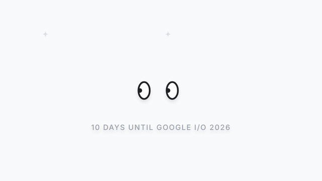
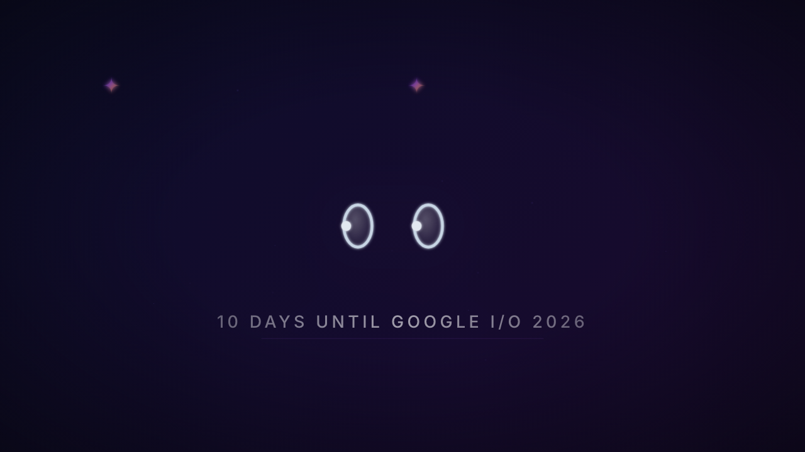
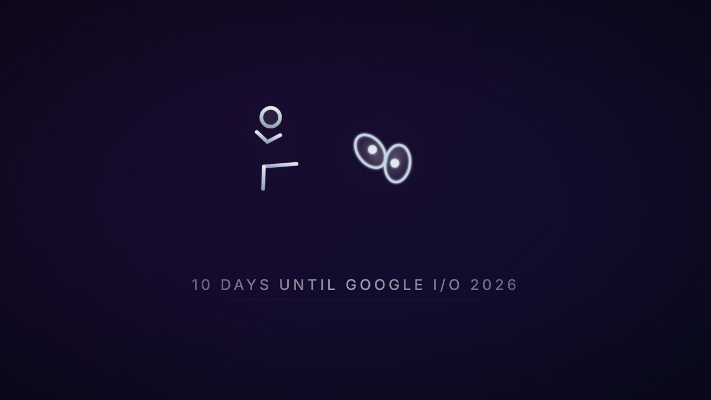
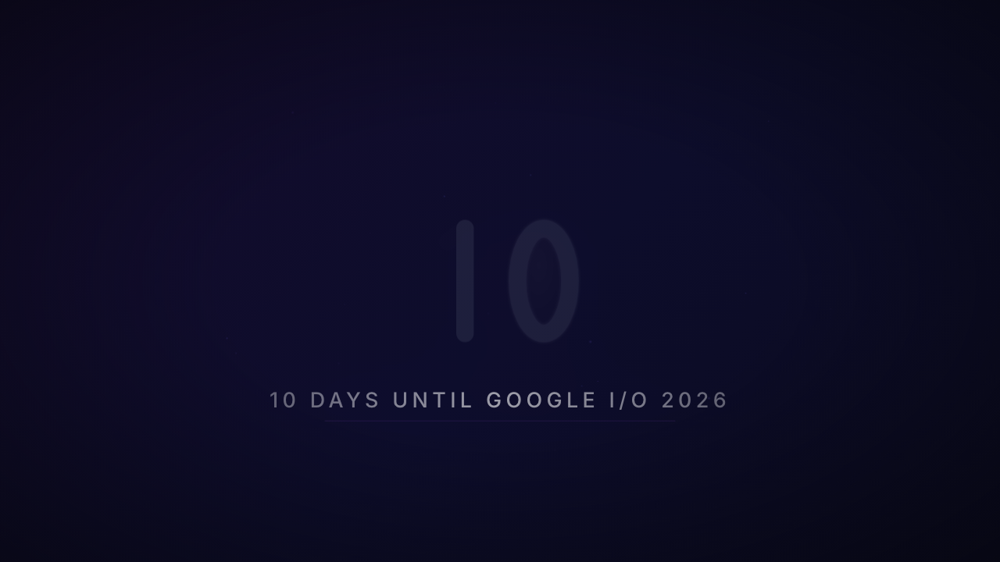

<div align="center">



</div>

# Stick Figure — 10 Days Until Google I/O 2026

A 12-second looping SVG animation where two Gemini-style eyes float innocently, a stick figure runs in and jump-kicks one offscreen, a staff flies in and bonks the figure away, and then the remaining eye morphs into a **0** while the staff becomes a **1** — forming **10** — punctuated by a burst of Gemini-gradient star particles. It loops forever. No interaction required. Just vibes.

## Quick Start

```bash
git clone https://github.com/andrewvoirol/ais-stick-figure-10-days-until-google-i-o-2026.git
cd ais-stick-figure-10-days-until-google-i-o-2026
npm install
npm run dev
```

Open [localhost:3000](http://localhost:3000).

## How It Works

Just watch. Two glowing eyes look around on a dark field. A stick figure enters stage left and roundhouse-kicks the left eye into orbit. A staff whips in from the right and launches the stick figure offscreen. The staff straightens into a "1", the remaining eye swells into a "0" — **10** — and 45 gradient star particles explode outward. Everything resets. Repeat forever.

Under the hood, five SVG element groups share a single 12-keyframe timing array. Every `x`, `y`, `opacity`, `rotate`, `scale`, `strokeWidth`, `rx`, `ry` property is driven by a declarative Framer Motion keyframe sequence — no imperative timeline controller, no canvas, no WebGL. It's raw SVG with attitude.

## Tech Stack

| Layer | Detail |
|-------|--------|
| **Framework** | React 19 + TypeScript |
| **Build** | Vite 6 |
| **Styling** | Tailwind CSS v4 + custom CSS properties |
| **Animation** | Motion (Framer Motion v12) — declarative keyframes |
| **Design** | Dark theme, glassmorphic eyes, Gemini gradient particles, ambient floating dots, vignette overlay |

## The Animation

<div align="center">

| Eyes watching | Stick figure enters | The "10" reveal |
|:---:|:---:|:---:|
|  |  |  |

</div>

Five synchronized element groups tell the story:

1. **Right Eye** — starts as an eye, morphs into a thick-stroked "0"
2. **Left Eye** — gets roundhouse-kicked offscreen by the stick figure
3. **Stick Figure** — runs in, kicks, gets bonked by the staff, tumbles away
4. **Staff** — flies in from the right, becomes the "1" (serif flag pops in)
5. **45 Burst Particles** — Gemini-palette star shapes explode and rain down

## License

[Apache-2.0](LICENSE)
